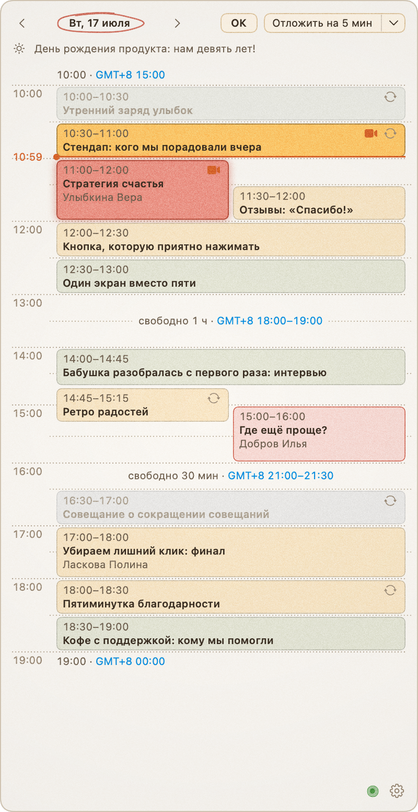
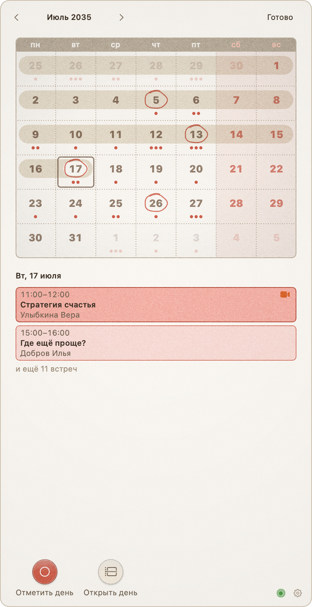
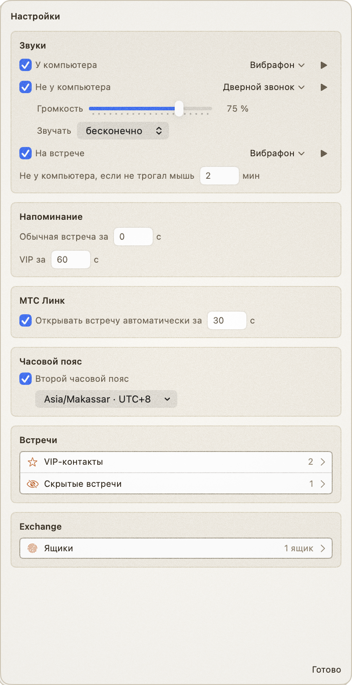

# Butler

Помощник на рабочий день для macOS. Живёт иконкой в строке меню: показывает день встреч из
Microsoft Exchange, напоминает о них звуком и окном и сам открывает встречу в МТС Линк.

| День и напоминание | Месяц | Настройки |
|---|---|---|
|  |  |  |

## Установка

Нужны macOS 15+, Swift 6 (Xcode или Command Line Tools) и доступ к серверу Exchange с EWS и
входом по NTLM. Если сервер во внутренней сети, нужен и VPN.

```sh
make install     # собрать, положить в ~/Applications и запускать при входе
make uninstall   # убрать приложение; настройки и журнал останутся
```

После установки Butler запускается сразу и перезапускается сам, если упал.

## Первый запуск

Щёлкните по иконке, откройте шестерёнку в правом нижнем углу, затем «Ящики». Butler спрашивает
Touch ID или пароль Mac при каждом открытии: в этом окне пароли видны открытым текстом. Щелчок мимо окна
его не закрывает, чтобы можно было скопировать пароль из другого приложения. Закрытие щелчком по иконке
сбрасывает несохранённые правки. Ящики задаются текстом:

```ini
[ivanov@example.com]
login = DOMAIN\ivanov
password = пароль
server = mail.example.com
```

`server` — хост, как в Outlook, или полный адрес EWS. Пароль хранится зашифрованным.

## Как пользоваться

**Строка меню.** Иконка и отсчёт до ближайшей встречи, если до неё не больше 4 часов.

- Перед VIP-встречей стоит красное «VIP».
- Опаздываете — мигает красный отсчёт с начала встречи.
- За 12 часов до первой встречи рабочего дня появляется будильник и её время, за 9 часов время
  начинает мигать: пора спать.
- Перед автооткрытием МТС Линк иконка становится камерой в кольце отсчёта.
- Нет связи с Exchange 10 минут — красный календарь с восклицательным знаком.

**Окно.** Открывается щелчком по иконке. Это день на шкале времени с карточками встреч:

- стрелки ‹ › листают дни, «Сегодня» возвращает к сегодняшнему;
- щелчок по карточке открывает участников и описание; ссылки и почта в описании кликабельны;
- колокольчик при наведении на карточку пропускает встречу или возвращает её;
- камера подключает к встрече, она есть за 10 минут до начала и пока встреча идёт;
- внизу подробностей можно пропустить всю серию или скрыть встречу корзиной;
- звезда у организатора делает его VIP, кругляш «VIP» внизу — всю серию или разовую встречу;
- щелчок по организатору или участнику открывает кнопку «Добавить в VIP» или «Убрать из VIP».

**Клавиши.**

| Клавиша | На дне | На месяце |
|---|---|---|
| ← → | предыдущий и следующий день | выбрать соседний день |
| ↑ ↓ | — | выбрать день на неделю раньше или позже |
| Пробел | — | обвести день кружком или снять отметку |
| Return | открыть месяц | открыть выбранный день |
| Esc | закрыть окно | вернуться к дню |
| ⌃C или ⌘C | скопировать карточку картинкой | скопировать карточку картинкой |

Окно, открытое щелчком по иконке, сразу принимает клавиши. Окно напоминания — только после щелчка по
нему: оно всплывает, пока вы печатаете в другом приложении. Esc в нём откладывает напоминание.

**Календарь на месяц.** Открывается щелчком по дате в заголовке.

- Красные точки под числом — важные встречи этого дня.
- Нерабочие дни подкрашены, выбранный день в рамке, прошедшие — под змейкой.
- Щелчок по дню показывает внизу его VIP-встречи.
- Двойной щелчок или «Открыть день» открывают день на шкале.
- «Отметить день» обводит число кружком.
- ‹ › листают месяцы, «Готово» или Escape возвращают к прежнему дню.

**Связь с Exchange.** Точка у шестерёнки: зелёная — связь есть, красная и мигает — хотя бы один ящик
не отвечает, серая — проверять нечего. Кольцо вокруг неё — отсчёт до следующей проверки. Щелчок по
точке показывает состояние каждого ящика, а у остановленного — кнопку «Проверить снова».

Если связи нет 10 минут (при неверном пароле или отсутствии доступа — сразу), рядом с точкой
появляется «Нет связи с …», и окно один раз открывается само. Расписание остаётся на экране,
напоминания работают.

**Напоминание.** О встрече Butler напоминает в момент её начала, о VIP-встрече — за минуту. Окно
открывается само, через секунду звучит звук. Неотвеченное напоминание живёт до 10-й минуты встречи.
В заголовке окна три кнопки:

- «ОК» — выключить: больше не звенит, окно закрывается. Камера «Подключиться» делает то же самое и
  открывает встречу;
- «Отложить на 5 мин» — окно закрывается, напоминание зазвенит снова. Если ничего не нажать, кнопка
  срабатывает сама через 30 секунд. Щелчок мимо окна — тоже «Отложить»;
- ▾ — отложить на 10 или 15 минут или пропустить встречу.

Звук зависит от того, где вы:

| Ситуация | Когда | Звук по умолчанию |
|---|---|---|
| У компьютера | мышь или клавиатура трогались недавно | «Вибрафон», один раз |
| Не у компьютера | экран заблокирован или 2 минуты без мыши | «Дверной звонок» на 75 %, каждые 10 с |
| На встрече | занят микрофон | «Вибрафон», один раз |

**МТС Линк.** За 30 секунд до встречи со ссылкой МТС Линк Butler открывает её сам, когда освободится
микрофон. Перед этим на иконке заполняется кольцо отсчёта, а за секунду до открытия звучит тихое
«тк-тк»: Линк забирает фокус, и сигнал даёт время приготовиться. Открытая встреча — ещё не подключение:
напоминание придёт как обычно. Встречи с другими ссылками камера открывает в браузере.

**Настройки.** Изменения действуют сразу:

- звук каждой ситуации, его можно выключить; громкость и повторы звука «Не у компьютера»;
- когда напоминать об обычных и VIP-встречах;
- через сколько минут вы считаетесь ушедшим;
- автооткрытие МТС Линк и его срок;
- второй часовой пояс: им подписаны края дня, перерывы и время встречи («GMT-3 …»);
- VIP-контакты: встреча VIP, если кто-то из списка её организует или в ней участвует;
- скрытые встречи с кнопкой «Вернуть»; пропущенная серия возвращается с карточки кнопкой «Вернуть всю серию»;
- ящики Exchange.

## Файлы на диске

| Файл | Что в нём |
|---|---|
| `~/.config/butler/config.json` | Настройки. Ящики с зашифрованными паролями, права 600 |
| `~/Library/Application Support/Butler/state.json` | Решения по встречам, кэш встреч, связь по ящикам, производственный календарь |
| `~/Library/Logs/Butler/exchange.log` | Журнал обращений к Exchange: строка на запрос, без паролей и тем |

## Что уходит в сеть

- Запросы к серверу Exchange из ваших настроек.
- Запрос к [isdayoff.ru](https://isdayoff.ru) за производственным календарём России. В нём только
  год. Без календаря нерабочими считаются суббота и воскресенье.

Телеметрии нет. Встречи открываются в МТС Линк или браузере.

## Как устроено

Один исполняемый SwiftPM-таргет на AppKit и SwiftUI, без сторонних зависимостей.

- **Расписание.** Раз в минуту `FindItem` проверяет сегодняшний день, раз в 10 минут — окно
  «сегодня + 7 дней». `GetItem` читает только новые и изменённые встречи. Другие дни читаются, когда
  их открывают. Кэш лежит в `state.json`, поэтому расписание видно сразу после запуска и без связи.
- **Несколько ящиков.** День собирается из всех ящиков: одна встреча из двух ящиков — одна карточка.
- **Соединение.** Своё TLS-соединение с HTTP/1.1 и NTLMv2 вместо URLSession: причина в начале `NTLM.swift`.
- **Бережность к серверу.** Нет сети — повтор через 2 минуты. Сервер не ответил — пауза растёт от 2 до
  30 минут. Сервер просит подождать — Butler ждёт весь срок. Неверный пароль, нет доступа, чужой
  сертификат, неверный адрес — ящик остановлен до смены настроек или «Проверить снова». Предохранитель
  останавливает ящик после 2000 запросов за час, это на порядок выше обычной работы.
- **Тик раз в секунду.** Состояние каждой встречи вычисляется из времени и решений чистыми функциями
  в `Reminders.swift`. Событийной машины нет.
- **Звуки** синтезируются в памяти, звуковых файлов нет. Они играют во встроенных динамиках, а без них —
  в выходе по умолчанию. На время звука «Не у компьютера» громкость поднимается и потом возвращается.
- **Звонок** определяется по занятому микрофону через CoreAudio. Особых разрешений не нужно.
- **Окно** — неактивирующая `NSPanel` поверх всех окон. Она не забирает фокус у текущего приложения.

## Карта файлов

```text
Sources/Butler/
├── App.swift        # точка входа: строка меню, тик, связывание всего остального
├── Exchange.swift   # запросы к EWS, итоги и повторы, кэш ящиков, шифрование паролей, индикатор, окно «Ящики»
├── NTLM.swift       # соединение с Exchange: TLS, HTTP/1.1, вход по NTLMv2
├── Schedule.swift   # встреча и день из кэшей ящиков, ссылка и описание, VIP, свежесть
├── Reminders.swift  # модель состояний: фазы, «звенит», «опаздываю», вид карточки, часы
├── Panel.swift      # окно: стопка карточек дней, месяц и настройки поверх, заголовок
├── Month.swift      # календарь на месяц, отметки, производственный календарь
├── Timeline.swift   # раскладка дня по дорожкам, шкала, подписи времени
├── Card.swift       # карточка встречи, подробности, действия, палитра Ink
├── Alarm.swift      # звуки, ситуации, проигрывание и громкость, присутствие у экрана
├── MTSLink.swift    # открытие ссылок, занят ли микрофон, автооткрытие
└── Settings.swift   # config.json и state.json, окно настроек
Tests/
├── Exchange.swift   # разбор ответов EWS, сборка дня, повторы, текст ящиков, пароли, NTLM
├── Month.swift      # сетка месяца, точки VIP, оценка загрузки, производственный календарь
├── Reminders.swift  # модель состояний, часы, будильник, свежесть
├── Timeline.swift   # раскладка дня
└── Settings.swift   # запись конфига без потери ручных правок, старые форматы
Support/
├── Info.plist       # приложение без Dock
├── com.butler.plist # LaunchAgent: запуск при входе
└── demo.py          # выдуманный календарь для скриншотов
Docs/                # скриншоты для README
AGENTS.md            # принципы проекта
```

## Разработка

```sh
make test        # тесты, к серверу не обращаются
make sounds      # проиграть звуки по умолчанию
make screens     # снять скриншоты заново
```

`make screens` кладёт выдуманные настройки и встречи из `Support/demo.py` в подставную домашнюю папку
(`CFFIXED_USER_HOME`) и сохраняет карточки в `Docs/`. Настоящие данные и сервер не участвуют, а сам
Butler про выдуманные встречи ничего не знает.

Сервер Exchange боевой, поэтому интерфейс проверяют с `--offline`: ни одного обращения к серверу,
только кэш. `--now` сдвигает часы, чтобы прожить другой день заранее. Вторая копия Butler сразу
завершается, так что сначала остановите установленную:

```sh
launchctl bootout gui/$(id -u)/com.butler
~/Applications/Butler.app/Contents/MacOS/Butler --offline --now 2026-10-23T13:58 &
# … проверка …
pkill -f "Butler --offline"; launchctl bootstrap gui/$(id -u) ~/Library/LaunchAgents/com.butler.plist
```

С `--now` не сохраняется `state.json`, но `config.json` пишется как обычно, а МТС Линк открывается
по-настоящему.

Ещё полезно:

- `Butler --dump YYYY-MM-DD` печатает собранный из кэша день, без сервера;
- перезапуск в пределах 10 минут от последнего чтения стоит только проверки сегодняшнего дня;
- сколько запросов ушло, видно по журналу: `cut -c1-13 ~/Library/Logs/Butler/exchange.log | sort | uniq -c`.

Принципы проекта — в [AGENTS.md](AGENTS.md).
